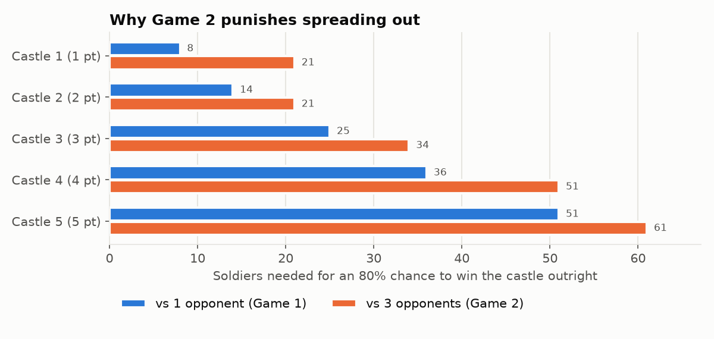
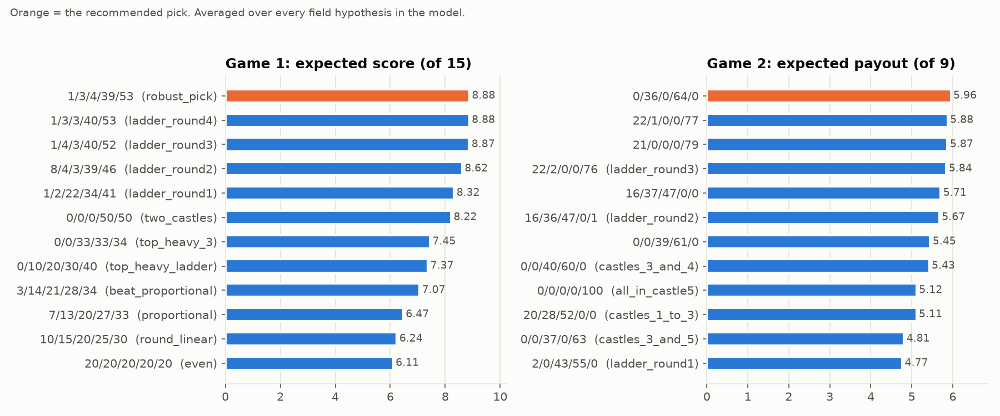

# Strategy 1, explained: solving the Castle Challenge with probability

*A plain-English walkthrough. No maths background needed. Every number here comes
from `results/strategy1_results.json`, produced by `analysis.py`.*

---

## The answer this approach gives

| | Castle 1 | Castle 2 | Castle 3 | Castle 4 | Castle 5 | Expected result |
|---|---|---|---|---|---|---|
| **Game 1** | 1 | 3 | 4 | 39 | 53 | **8.88 points** per matchup (an average player gets 7.5) |
| **Game 2** | 0 | 36 | 0 | 64 | 0 | **5.96 payout** (an average player gets 3.75); first place about 60% of the time |

The final submission in the top-level `README.md` combines this with Strategy 2.
For Game 1 it adjusts these numbers. For Game 2 it is practically the same answer.

---

## 1. The rules, in one breath

You split 100 soldiers over five castles worth 1 to 5 points (15 in total).

- **Game 1:** you are compared with every other applicant one at a time. On each
  castle, whoever sent more soldiers gets its points, and a tie splits them. Your
  score is your average.
- **Game 2:** you're dropped into random groups of four. Each castle goes to whoever
  sent the *most* of the four. Only your finishing place pays: 1st = 9, 2nd = 4,
  3rd = 2, 4th = 0.

## 2. The one probability rule that does most of the work

Your expected points from a castle are:

> **castle value × the chance you out-bid your opponent there** (a tie counts as half)

That's it. Because your score is an *average* over many matchups, each castle
becomes its own little bet, and the five bets just add up. So the whole Game 1
problem reduces to:

*"Given what other people tend to put on each castle, where does each extra
soldier buy the most points?"*

A computer can then check every one of the **4,598,126** legal ways to split 100
soldiers and find the best one exactly.

In **Game 2** the rule gets harsher. You have to beat **all three** opponents on a
castle, not one. If 80% of people send fewer than X soldiers somewhere, the chance
that all three of your group-mates do is only 0.8 × 0.8 × 0.8 = **51%**. That cube
is why the two games need different answers:

| Castle | Soldiers for an 80% chance vs **1** opponent | vs **3** opponents |
|---|---|---|
| 1 (1 pt) | 8 | 21 |
| 2 (2 pts) | 14 | 21 |
| 3 (3 pts) | 25 | 34 |
| 4 (4 pts) | 36 | 51 |
| 5 (5 pts) | 51 | 61 |

Spreading out in Game 2 means you come second on every castle and win nothing.

## 3. Step one: find the "perfect" strategy, and see why it isn't enough

Game theorists have a name for this game (Colonel Blotto) and a notion of a perfect,
unbeatable strategy: the **Nash equilibrium**. For Game 1 it works out to this:

> **Pick each castle's number at random, anywhere from 0 up to 13⅓ × its value**
> (castle 1: 0-13, castle 2: 0-27, castle 3: 0-40, castle 4: 0-53, castle 5: 0-67),
> keeping the total at 100.

The program confirmed it two ways: with the exact formula, and by letting a
computer play itself 6,000 times and converge to it. The best possible reply to
the result scores 7.76, barely above the 7.5 you get by default. So it is very
close to unbeatable.

Here's the catch. **Against the perfect strategy, every sensible allocation scores
exactly 7.5, which is the average.** 7/13/20/27/33 gets 7.5, and so do
0/0/33/33/34 and 0/0/0/50/50. The equilibrium is a *shield*, not a *sword*. It
guarantees you can't be exploited, but it can't exploit anyone else either. You
only do better than average by exploiting the *mistakes* real players make.

### The trap most people (and AIs) fall into

The *average* of the perfect random strategy is 7/13/20/27/33, which is "soldiers in
proportion to points". Many people, and many AI chatbots, submit exactly that as
"the optimal answer". But playing the average every time is **not** the same as
playing randomly. It's a fixed, predictable target.

- **3/14/21/28/34** beats it **14 to 1**: lose castle 1, win everything else by one soldier.
- In the realistic field built below, 7/13/20/27/33 averages only 6.47, which is
  below average.

That is what "beating the most optimal strategy" means in practice. The "optimal"
answer everyone quotes is beatable by one soldier.

## 4. Step two: model the other applicants, round by round

Nobody knows what the real applicants submitted, so the analysis builds a
**probability model of the field** out of how people think:

- **Round 0, people who don't think about others.** Proportional (7/13/20/27/33),
  tidy round numbers (10/15/20/25/30, 0/10/20/30/40), 20 everywhere, "ignore the
  small castles" (0/0/33/33/34), and some random picks. Because you said most
  applicants use AI, the AI-style proportional answer gets the biggest share.
- **Round 1, people who think one step ahead:** "everyone does round 0, so I'll beat it."
- **Round 2:** "everyone does round 1, so I'll beat *that*." And so on.

This is a standard behavioural-economics model (the "cognitive hierarchy"). Most
people stop at 0 to 2 rounds, a few go deeper. Each round's thinkers don't all
land on one identical answer. They pick *good* answers with some natural
variation, the way real people do.

### The most winning move in each round, Game 1

| Round | Best move | Score vs the previous round's players | What it's doing |
|---|---|---|---|
| 1 | 1/2/22/34/41 | 11.3 vs round 0 | "+1 above the round numbers" on castles 3-5, give up 1-2 |
| 2 | 8/4/3/39/46 | 10.7 vs round 1 | round-1 players crowd castle 3 at 21-23, so **abandon castle 3** |
| 3 | 1/4/3/40/52 | 9.0 vs round 2 | same idea, more on castle 5 |
| 4 | 1/3/3/40/53 | 7.3 vs round 3 | the ladder settles: **stack castles 4 and 5 and give up the rest** |

### The most winning move in each round, Game 2

| Round | Best move | Payout vs the previous round | What it's doing |
|---|---|---|---|
| 1 | 2/0/43/55/0 | 8.7 vs round 0 | naive players pile onto castle 5, so take 3+4 (7 points) |
| 2 | 16/36/47/0/1 | 7.3 vs round 1 | round 1 grabs 3+4, so take the cheap castles 1-3 |
| 3 | 22/2/0/0/76 | 7.4 vs round 2 | round 2 left castle 5 bare, so take 5+1 |

Game 2 never settles. It's rock-paper-scissors: whatever's popular has a counter.
That's why the final answer can't be "beat round N". It has to do well against a
whole *mix* of rounds.

## 5. Step three: choose the move that's best on average across many possible worlds

Since the true mix of thinkers is unknown, the program tried **64 different
versions of the field** for Game 1 and **36** for Game 2. They vary:

- how many people are AI-proportional, round-number, top-heavy, or random,
- how many rounds deep people think,
- how sloppy their answers are, and
- whether 15% of players play the perfect (equilibrium) strategy.

It then picked the allocation with the best average across all of them.

**Game 1: `1/3/4/39/53`.** It averages 8.88 and is never below 7.38 in any of
the 64 worlds. It wins castle 4 about 85% of the time and castle 5 about 89% of the
time. That's 9 of the 15 points nearly locked, while it concedes castles 1-3 cheaply.

| Allocation | Average score across the 64 worlds |
|---|---|
| **1/3/4/39/53 (pick)** | **8.88** |
| 1/2/22/34/41 (round-1 move) | 8.32 |
| 0/0/0/50/50 | 8.22 |
| 0/0/33/33/34 | 7.45 |
| 3/14/21/28/34 (beats the textbook answer) | 7.07 |
| 7/13/20/27/33 (textbook "optimal") | 6.47 |
| 10/15/20/25/30 | 6.24 |
| 20/20/20/20/20 | 6.11 |

**Game 2: `0/36/0/64/0`**, meaning castle 2 with 36 and castle 4 with 64. It
averages 5.96 (finishing 1st about 60% of the time and in the top two 79%), and is
never below 5.14 in any of the 36 worlds.

| Allocation | Average payout across the 36 worlds |
|---|---|
| **0/36/0/64/0 (pick)** | **5.96** |
| 22/1/0/0/77 (castles 5+1) | 5.88 |
| 16/37/47/0/0 (castles 1-3) | 5.71 |
| 0/0/40/60/0 (castles 3+4) | 5.43 |
| 0/0/0/0/100 (all on castle 5) | 5.12 |
| 0/0/37/0/63 (castles 3+5) | 4.81 |
| 0/0/0/50/50 | 3.35 |
| 0/0/33/33/34 | 2.89 |
| 7/13/20/27/33 | 2.11 |

### Why castle 2 plus castle 4 wins Game 2

- **64 on castle 4** is more than almost anyone sends there. People who go big
  usually go big on castle 5, and 3+4 players put 50-60 on castle 4.
- **36 on castle 2** is far above what anyone bothers to send to a 2-point castle.
- That's **6 points almost guaranteed**. To beat you, a single opponent must win
  castle 5 *and* castle 3 (8 points). In practice castles 5, 3 and 1 usually go to
  *different* people, who end up with 5, 3 and 1, so your 6 comes first.
- It's a "where nobody is looking" move. It sits at a point in the
  rock-paper-scissors cycle that none of the popular plans attack.

## 6. The perfect strategy for Game 2 looks nothing like Game 1's

The analysis also approximated the equilibrium of the four-player game. It is far
more extreme than Game 1's:

- About 22% of the time the "perfect" player puts **all 100 on castle 5**.
- Over half the time it contests only 1 or 2 castles.
- On *average* it still looks like 6/13/18/26/36, roughly proportional, which
  again shows how misleading averages are here.

This approximation isn't fully converged: the best reply scores 4.30 against it
instead of 3.75. Treat it as a description of the *style* of perfect play, not an
exact recipe.

## 7. Critical findings

1. **The "optimal" answer people quote (7/13/20/27/33) is a trap.** It's the average
   of the perfect strategy, not the strategy itself, and it loses to a +1 tweak 14-1.
   In a realistic field it scores below average in both games.
2. **The perfect (equilibrium) strategy only guarantees average.** Every reasonable
   allocation scores exactly 7.5 against it. Winning requires exploiting real players.
3. **Thinking one step ahead pays a lot. Thinking many steps ahead pays less and less.**
   Round 1's best move scores 11.3 against round-0 players, 3.8 above average. Round
   4's best move scores only 7.3 against round-3 players, slightly *below* average,
   because each deeper layer of thinkers is harder to exploit.
4. **Game 1 rewards concentration on the big castles.** The ladder settles on stacking
   castles 4 and 5 and conceding 1-3.
5. **Game 2 is rock-paper-scissors.** Any popular plan has a counter. The robust move
   is to take castles the popular plans leave under-defended (2 and 4) by a margin
   nobody else bothers with.
6. **The cube rule:** beating three opponents is much harder than beating one, so
   in Game 2 half-measures are worthless. Win a castle outright or don't contest it.

## 8. What this approach can't know

- The field model is built from reasoning and general knowledge of how people play
  Blotto games, not from real submissions. If the real applicants behave very
  differently, the best answer moves. The worst case in the 64 Game 1 worlds is a
  very top-heavy, very sophisticated field. There, abandoning castle 5 (5/7/32/46/10)
  would have been better, though the pick still scored 7.38.
- Strategy 2 attacks the same question from the opposite direction: individual
  simulated applicants, 30 of them real AI answers. The two agree strongly on
  Game 2. See `../strategy2_simulation/EXPLAINED.md` and the top-level `README.md`.
