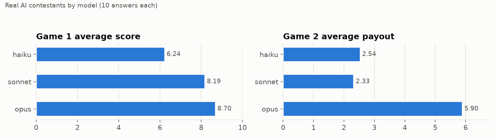
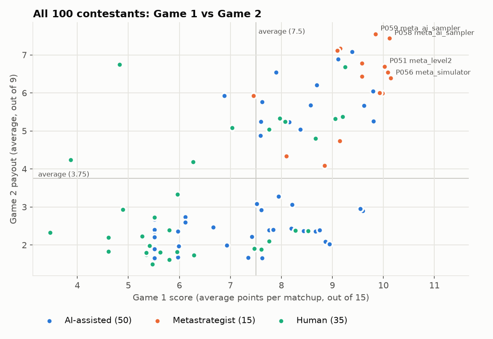
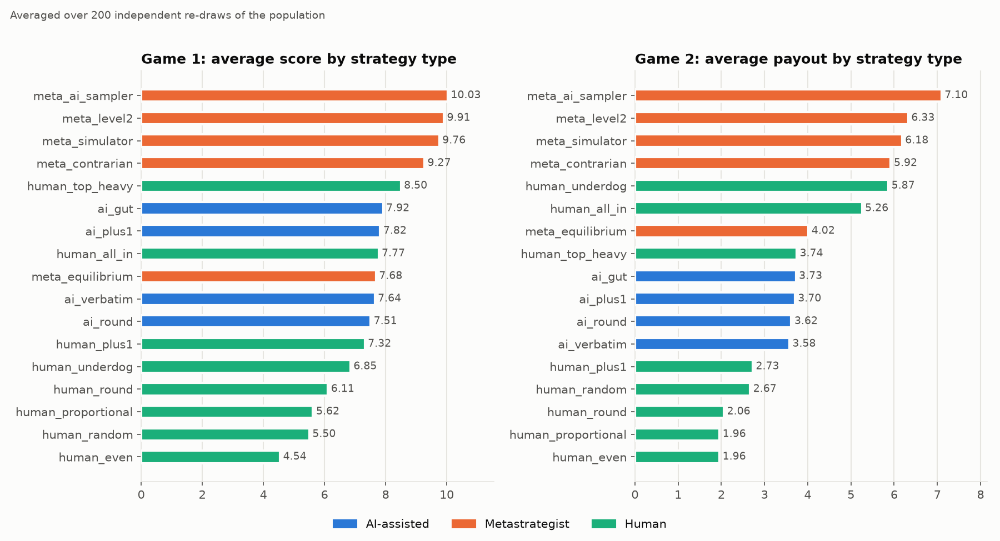

# Strategy 2, explained: 100 simulated applicants, one tournament

*A plain-English walkthrough. Every number here comes from
`results/simulation_results.json` and `contestants/population.json`, produced by
`run_simulation.py`.*

---

## The answer this approach gives

Strategy 2 builds a realistic crowd of 100 applicants, plays both games exactly
by the rules, and then asks: *"If I were applicant #101, what should I submit to
beat this crowd?"*

| | Castle 1 | Castle 2 | Castle 3 | Castle 4 | Castle 5 | Result against the simulated crowd |
|---|---|---|---|---|---|---|
| **Game 1** | 2 | 16 | 1 | 38 | 43 | **10.30** points per matchup (average is 7.5); **1st of 101 in 89%** of 200 re-runs, top 5 in 100% |
| **Game 2** | 3 | 35 | 0 | 62 | 0 | **8.06** payout (average is 3.75); finishes 1st in about 87% of its groups; **1st of 101 in 80%** of re-runs |

---

## 1. Who the 100 applicants are

You expected most applicants to use AI, so 65 of the 100 are AI-influenced.

| Group | How many | Who they are |
|---|---|---|
| **Real AI answers** | 30 | The exact challenge text was given to **30 separate, fresh AI chats** (Claude Haiku, Sonnet and Opus, 10 each, roughly the free, standard and premium tiers people use). Each was asked in one of 5 ways people really ask: just pasting it, "what's optimal?", "quick, I have 3 minutes", "others use AI too, beat them", "use game theory". None saw the others or this project. These applicants submit the AI's answer unchanged. |
| **Asked an AI, then fiddled** | 20 | Took one of those AI answers and rounded it to 5s (7), moved a few soldiers on a hunch (7), or added +1 to beat ties (6). |
| **Metastrategists** | 15 | People who think hard about *other* applicants, 3 of each type: **level-2 thinkers** (assume the crowd is proportional/AI-ish and compute the exact best reply), **simulators** (imagine their own crowd and simulate it, like this project), **AI samplers** (ask the AI 5-10 times to see what AI users will submit, then counter it), **equilibrium players** (play the textbook "perfect" random strategy), and **contrarians** (assume everyone fights over castles 4-5 and dodge it). |
| **Solving it by hand** | 35 | Proportional splits (7), tidy round numbers (5), 20 everywhere (4), "skip the cheap castles" (5), all-in on one or two castles (3), "one more than what others do" (4), random guesses (4), "take the castles others ignore" (3). |

**Why 30 real AI answers?** With 30 independent samples, any answer style that at
least 10% of AI replies would give shows up with 95% probability. Each modelled
person also makes their own random choices, so no two think in lockstep.

## 2. How the contest was run

- **Game 1:** every applicant was matched against every other applicant, which is
  4,950 matchups, scored exactly by the rules.
- **Game 2:** everyone was shuffled into 25 groups of four, **20,000 times**, with
  the 9/4/2/0 payouts and tie-splitting applied each time.
- **Then everything was done again 200 times** with freshly drawn crowds: AI
  answers resampled, and every modelled person deciding again. This separates
  strategies that are actually good from ones that got lucky in one crowd.

## 3. What the AIs said

This matters most if, as you suspect, most applicants just ask an AI.

**Game 1: the 30 AI answers fell into five clusters**

| Cluster | Count | Which AI | Average score |
|---|---|---|---|
| Textbook proportional, exactly 7/13/20/27/33 | 7 | all Haiku | **5.46** (bottom quarter) |
| Just above the crowd on castles 3-5, almost nothing on 1-2 (e.g. 1/2/24/32/41) | 9 | Sonnet 5, Opus 4 | **9.29** |
| Proportional with "+1" tweaks, keeps 10-14 on castle 2 (e.g. 2/11/22/29/36) | 9 | Sonnet 5, Opus 4 | 7.38 |
| Round-number top-heavy (e.g. 0/10/20/30/40) | 3 | all Haiku | 7.87 |
| Contrarian, starves castle 5 (e.g. 11/18/32/36/3) | 2 | Opus | 8.79 |

**Game 2: four clusters**

| Cluster | Count | Which AI | Average payout |
|---|---|---|---|
| Two-castle bet (castles 3+5, 3+4 or 4+5, e.g. 0/0/37/0/63) | 9 | Opus 8, Haiku 1 | **5.77** |
| Three castles, skipping castle 4 or 5 (e.g. 21/28/51/0/0) | 2 | Opus | 5.71 |
| Roughly even over castles 3-5 (e.g. 0/0/33/33/34) | 7 | all Sonnet | **2.20** (bottom quarter) |
| Top-heavy ladder, most on castle 5 (e.g. 0/0/20/30/50) | 12 | Haiku 9, Sonnet 3 | 2.36 |

| AI model | Game 1 average | Game 2 average |
|---|---|---|
| Opus (premium) | 8.70 | **5.90** |
| Sonnet (standard) | 8.19 | 2.33 |
| Haiku (fast/free tier) | 6.24 | 2.54 |

The *way people asked* mattered less than *which AI* they asked. "Quick, just give
me numbers" was worst in both games (6.60 and 3.02). "Others use AI too, beat
them" was best in Game 1 (8.41), and "what's optimal?" was best in Game 2 (3.91).

## 4. The leaderboards (baseline crowd)

**Game 1, top 5**

| Rank | Applicant | Type | Allocation | Score |
|---|---|---|---|---|
| 1 | P056 | simulator | 1/1/23/33/42 | 10.14 |
| 2 | P058 | AI sampler | 4/15/0/37/44 | 10.12 |
| 3 | P057 | AI sampler | 4/17/0/37/42 | 10.09 |
| 4 | P051 | level-2 thinker | 1/1/23/34/41 | 10.02 |
| 5 | P052 | level-2 thinker | 1/2/23/33/41 | 9.98 |

The best *raw* AI answer came 8th: Opus, 1/3/22/32/42, 9.81. Bottom of the table:
random guesses (3.47) and 20/20/20/20/20 (4.61).

**Game 2, top 5**

| Rank | Applicant | Type | Allocation | Payout | Finished 1st |
|---|---|---|---|---|---|
| 1 | P059 | AI sampler | 9/35/0/55/1 | 7.55 | 78% |
| 2 | P058 | AI sampler | 8/23/0/1/68 | 7.43 | 75% |
| 3 | P063 | contrarian | 12/32/56/0/0 | 7.17 | 72% |
| 4 | P064 | contrarian | 0/0/44/56/0 | 7.12 | 74% |
| 5 | P011 | raw AI (Opus) | 0/0/42/58/0 | 7.08 | 71% |

Bottom: a random guess (1.49), 10/10/20/30/30 (1.62), and Haiku's 5/10/20/30/35 (1.65).

## 5. Which *types* of strategy win (averaged over 200 re-runs)

| Strategy type | Group | Game 1 avg (rank of 100) | Game 2 avg (rank of 100) |
|---|---|---|---|
| AI sampler | Metastrategist | **10.03** (4.8) | **7.10** (6.8) |
| Level-2 thinker | Metastrategist | 9.91 (5.3) | 6.33 (14.5) |
| Simulator | Metastrategist | 9.76 (10.5) | 6.18 (17.1) |
| Contrarian | Metastrategist | 9.27 (21.0) | 5.92 (19.5) |
| Skip the cheap castles | Human | 8.50 (34.2) | 3.74 (49.0) |
| AI + gut tweak | AI-assisted | 7.92 (44.6) | 3.73 (47.2) |
| AI + "+1" | AI-assisted | 7.82 (45.2) | 3.70 (47.8) |
| All-in on 1-2 castles | Human | 7.77 (47.4) | 5.26 (29.3) |
| Equilibrium ("perfect" random) | Metastrategist | 7.68 (48.7) | 4.02 (42.2) |
| **Raw AI answer** | AI-assisted | **7.64** (48.6) | **3.58** (51.6) |
| AI, rounded to 5s | AI-assisted | 7.51 (51.1) | 3.62 (50.8) |
| "One more than others" | Human | 7.32 (56.8) | 2.73 (69.3) |
| Take the ignored castles | Human | 6.85 (60.2) | 5.87 (19.6) |
| Round numbers | Human | 6.11 (74.6) | 2.06 (78.6) |
| Proportional | Human | 5.62 (82.7) | 1.96 (82.4) |
| Random guess | Human | 5.50 (80.3) | 2.67 (65.7) |
| 20 everywhere | Human | 4.54 (96.8) | 1.96 (81.7) |

**Who won the 200 tournaments outright:**
- **Game 1:** AI sampler 179 times, level-2 thinker 11, simulator 6, others 4.
- **Game 2:** AI sampler 152, simulator 22, contrarian 9, raw AI 7, "ignored castles" human 6, others 4.

## 6. Trends: what separates winners from losers

These are rank correlations across the 100 applicants. +1 means "more of this
always scores higher", -1 means "always lower", and 0 means no relationship.

| Feature of an allocation | Game 1 | Game 2 |
|---|---|---|
| How concentrated it is (a few big piles) | **+0.84** | **+0.81** |
| Size of the biggest pile | +0.72 | **+0.80** |
| Number of castles with 10+ soldiers | **-0.77** | **-0.69** |
| Soldiers on castle 4 | **+0.83** | +0.24 |
| Soldiers on castle 1 / castle 2 | -0.54 / -0.49 | -0.09 / -0.15 |
| Round-number piles (multiples of 5) | -0.46 | -0.39 |
| Skipping castle 5 entirely | -0.08 | **+0.33** |

In plain words:
- **Concentrate.** Spreading soldiers evenly is the single most reliable way to lose
  both games.
- **Avoid round numbers.** Everyone else is on 20, 25 and 30, and winners sit just
  above them.
- **In Game 2, skipping the 5-point castle tends to help.** Everyone fights over it,
  so the winners often let them.

## 7. The winning strategy: applicant #101

After the tournament, the program computed the best possible reply to the whole
crowd: exactly for Game 1, and by an exhaustive local search for Game 2. It then
checked that reply in all 200 re-drawn crowds.

### Game 1: `2 / 16 / 1 / 38 / 43`

| Castle | What the crowd typically sends | This pick | Share of matchups it wins there |
|---|---|---|---|
| 1 | half send 0-3 | 2 | 44% |
| 2 | median 11-12, 90% send 19 or fewer | **16** | 84% |
| 3 | **half the crowd sends 20-23**: the AIs' "+1 over 20" | 1 (surrender) | 7% |
| 4 | median 30, 90% send 37 or fewer | **38** | 91% |
| 5 | median 35, a quarter send 41+ | **43** | 86% |

**Why it works:** the AI crowd fights hardest over castle 3. Its typical "one more
than 20" lands at 21-23 and pushes the price of castle 3 way up. Castle 3 is only
worth 3 points, so this pick gives it up. It spends those soldiers where the crowd
is thin for the value: just over the crowd on castles 4 and 5, and a surprisingly
cheap win on castle 2, which most AIs starve.

### Game 2: `3 / 35 / 0 / 62 / 0`

- **62 on castle 4.** The most anyone in the crowd sends there is 61, so castle 4
  is won in essentially every group.
- **35 on castle 2.** Only about 1 in 10 applicants sends even 21 to castle 2, and
  nobody sends more than 35. It is won about 94% of the time.
- That's **6 points locked in**. The remaining castles (5, 3 and 1) usually go to
  *three different* opponents, the castle-5 fighters, the castle-3 fighters and
  whoever has spare change on castle 1, so 5, 3 or 1 points each. 6 beats all of them.
- It finished **in the top two 100% of the time** and **first about 87%**. The main
  danger is an opponent who wins castles 5 *and* 3 together (8 points), which is
  why the AI answers betting 0/0/37/0/63 are its rare nemesis.

## 8. Does the winner survive a different crowd?

The whole experiment was re-run with different mixes of applicants (60 re-draws each):

| Crowd | Game 1 pick, average | Game 1, beats all 100 | Game 2 pick, average | Game 2, beats all 100 |
|---|---|---|---|---|
| 17 AI users / 68 humans (+15 meta) | 9.94 | 13% | 8.16 | 98% |
| 34 AI / 51 humans | 10.12 | 58% | 8.07 | 92% |
| **50 AI / 35 humans (baseline)** | **10.31** | **80%** | **8.00** | **82%** |
| 68 AI / 17 humans | 10.48 | 65% | 8.03 | 65% |
| 85 AI / 0 humans | 10.65 | 50% | 7.93 | 15% |
| 0 metastrategists | 10.51 | 58% | 7.92 | 65% |
| 5 metastrategists | 10.45 | 62% | 7.91 | 52% |
| 30 metastrategists | 10.11 | 72% | 8.16 | 97% |
| 50 metastrategists | 9.86 | 57% | 8.20 | 88% |

Both picks stay **far above average in every crowd**: 9.9-10.7 against an
average of 7.5, and 7.9-8.2 against 3.75. What changes is whether someone *else*
happens to land even higher. When the crowd is almost all AI users, the AI-sampler
types (who tune themselves to exactly that crowd) sometimes edge past it in Game 2.

## 9. Critical findings on strategy trends

1. **Thinking about the other players is what wins, not maths skill.** All four top
   strategy types in both games are metastrategists. The "perfect" equilibrium
   strategy finishes mid-table (7.68 and 4.02), because it is built not to *lose*, not to *win*.
2. **The single best metastrategy is to ask the AI several times.** Asking 5-10 times
   shows what every other AI user is about to submit, and then you counter it. It
   won 179 of 200 Game 1 tournaments and 152 of 200 Game 2 tournaments.
3. **Submitting the AI's answer unchanged is average at best.** Raw AI answers ranked
   about 49th of 100 in Game 1 and 52nd in Game 2. Rounding them to 5s made Game 1
   slightly worse (7.51 vs 7.64), and small "+1" or gut tweaks added only about
   0.2-0.3 points.
4. **Which AI you ask matters a lot in Game 2.** Opus averaged 5.90, more than double
   Sonnet (2.33) and Haiku (2.54). Opus nearly always made a bold two-castle bet,
   while Sonnet's favourite, even thirds over castles 3-5, was among the worst answers.
5. **The textbook "optimal" answer, 7/13/20/27/33, is a losing answer.** Haiku gave it
   7 times out of 10, and it averaged 5.46 in Game 1. The applicants who split by
   points proportionally averaged 1.96 in Game 2, close to the bottom.
6. **Concentrate, avoid round numbers, and in Game 2 dodge the castle everyone wants.**
   These three habits explain most of the gap between winners and losers.
7. **The crowd's blind spots are castle 2 and castle 4.** The AI crowd over-fights
   castle 3 in Game 1 and castles 3-5 or castle 5 in Game 2, and leaves castle 2
   cheap in both games.

## 10. Limits of this approach

- The 30 real AI answers are all from Claude models. Real applicants also use
  ChatGPT, Gemini and others, which may cluster differently.
- The 70 modelled applicants are archetypes written by hand, not real people. The
  sensitivity table shows the conclusions hold across very different mixes, but a
  genuinely unexpected crowd could still differ.
- The AI-sampler applicants are slightly flattered here: they sample the *same* AI
  answers that are in the crowd, whereas a real person can only sample the AIs they
  have access to.

Strategy 1 (`../strategy1_probability/EXPLAINED.md`) answers the same question with
pure probability and no simulated people, and lands on almost the same Game 2 answer
(0/36/0/64/0). The top-level `README.md` combines the two.
